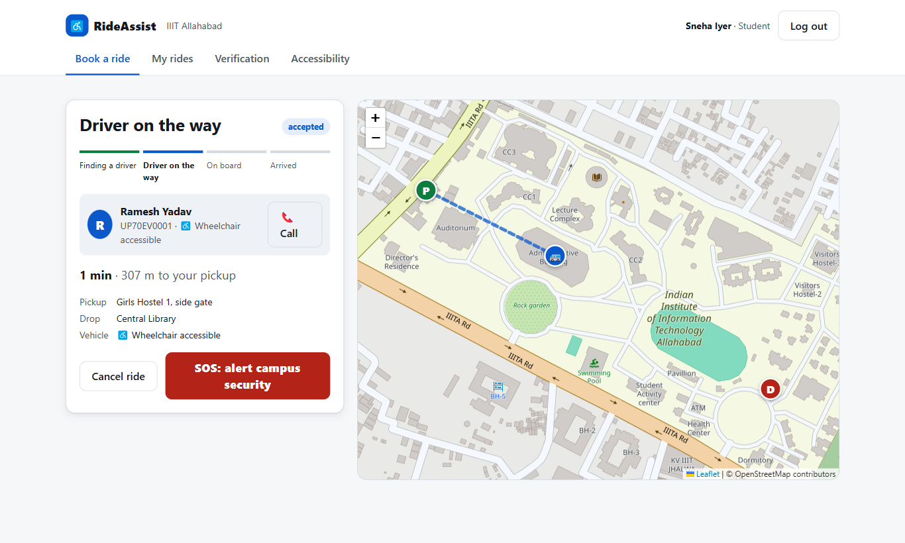
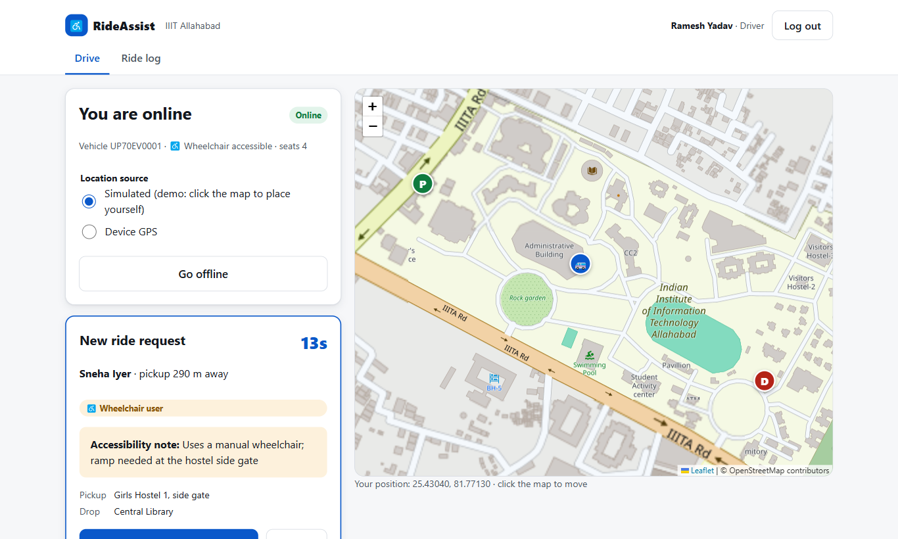
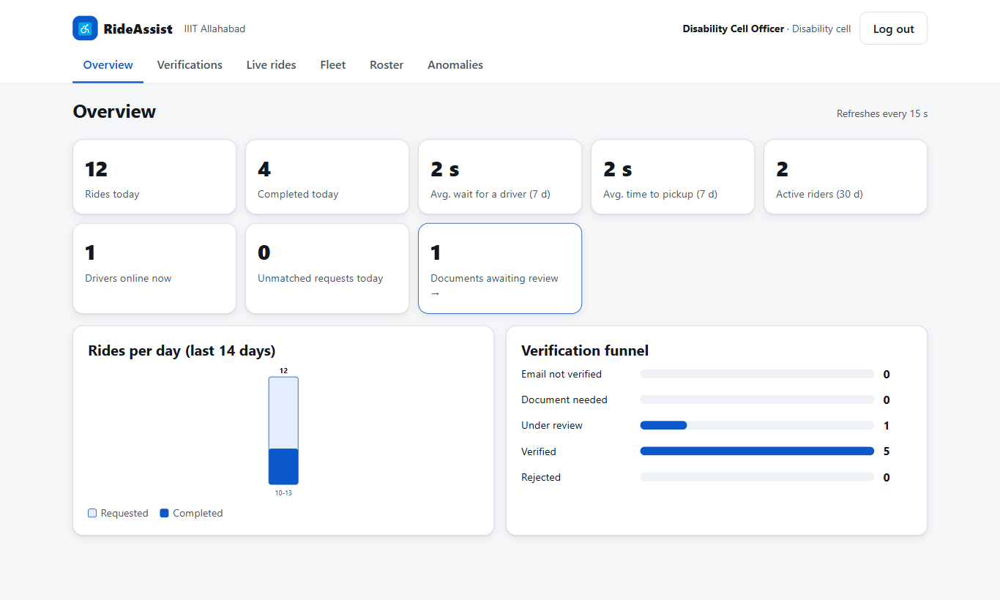
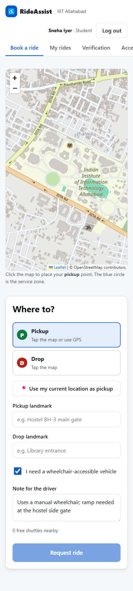
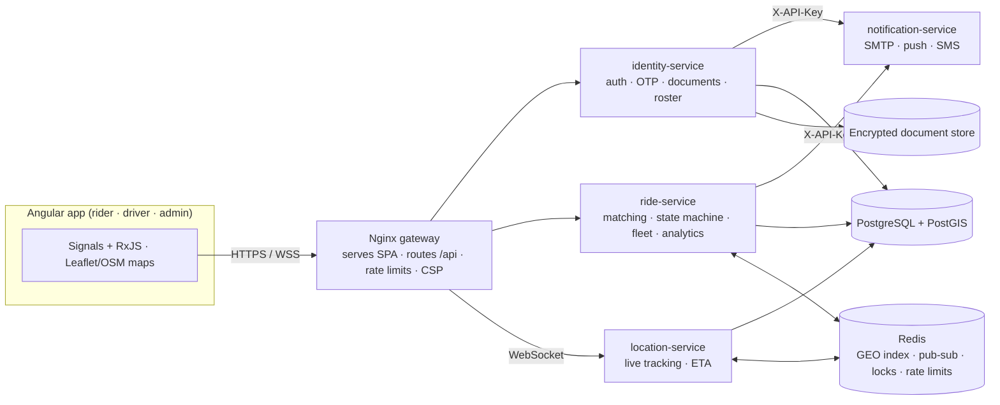

# RideAssist — Campus Accessibility Ride Platform

[](https://github.com/Gulshan77350/RideAssist--Campus-Accessibility-Ride-Platform/actions/workflows/ci.yml)

RideAssist is a full-stack, Uber/Ola-style ride-hailing platform for **verified PwD (Persons with
Disabilities) students**. It replaces the phone-call/WhatsApp campus shuttle with on-demand
booking, nearest-driver matching, live GPS tracking and an auditable verification pipeline. Rides
are free. The platform is multi-tenant, so any college can onboard.

- **Angular web app** with three role-based consoles: rider, driver and disability-cell admin.
  Live maps, WebSocket tracking, and WCAG 2.1 AA checked in CI.
- **Four FastAPI microservices** behind an Nginx gateway, on PostgreSQL + PostGIS and Redis.

| Rider: live tracking | Driver: timed ride offer |
|---|---|
|  |  |
| **Admin: analytics** | **Mobile booking** |
|  |  |

## Why it's more than a CRUD app

1. **A KYC-style verification gate.** College-domain email, then a match against the college's PwD
   roster, then an email OTP, then (as a fallback) an encrypted UDID/certificate upload reviewed by
   the disability cell. Every step is audited.
2. **A real-time dispatch core.** Redis GEO matching with 15-second offers that cascade to the next
   driver, a ride state machine that stays correct under races, and WebSocket live tracking fanned
   out over Redis pub-sub.
3. **Accessibility as a requirement, not a feature.** Riders' needs (wheelchair, ramp notes) travel
   with every ride to the driver. The UI is keyboard- and screen-reader-friendly and is
   axe-audited in CI.



## Quick start

Requires Docker Desktop.

```bash
cp .env.example .env
docker compose up -d --build
```

Open **http://localhost:8080** and click **Student**, **Driver** or **Admin** on the login page.
To watch a full ride, open the driver in one browser window and the student in another (or a
private window):

1. **Driver**: *Go online*. The location is simulated, so you can click the map to move.
2. **Student**: tap the map for pickup and drop, then *Request ride*.
3. **Driver**: accept the offer within 15 s. The van then drives itself toward the pickup, and the
   rider sees it move live.
4. **Driver**: *Start*, then *Complete*. The rider gets the rating screen.

| URL | What |
|---|---|
| http://localhost:8080 | The web app + API gateway |
| http://localhost:8025 | Mailpit: OTP and notification emails land here |
| http://localhost:8001/docs · 8002 · 8003 | Swagger for identity · rides · location |

**Seeded accounts:** student `iit2023004@iiita.ac.in` / `Student@123` (verified, wheelchair
user) · drivers `ramesh.driver@iiita.ac.in` (wheelchair-accessible van) and
`suresh.driver@iiita.ac.in` / `Driver@12345` · admin `admin@iiita.ac.in` / `Admin@12345`.
To try sign-up, register `iit2023002@iiita.ac.in` (*Priya Verma*), who is on the PwD roster and gets
auto-verified. Any other `@iiita.ac.in` address goes through the document-upload path.

### Frontend development (hot reload)

```bash
cd frontend && npm install && npm start     # http://localhost:4200, proxies /api to :8080
```

## What's built

| Area | Highlights |
|---|---|
| **Web app** | Angular 20 standalone components, signals and zoneless change detection · lazy-loaded per role (85 kB initial transfer) · functional route guards, plus an HTTP interceptor with single-flight token refresh · WebSocket client with first-message auth and backoff reconnect · Leaflet + OpenStreetMap, no API keys · driver GPS *or* built-in drive simulator for demos |
| **Accessibility** | 44 px targets, visible focus rings, skip link, `aria-live` announcements for ride status changes · every map fact also shown as text · native radio-group star rating · reduced-motion + dark-mode support · **zero serious/critical axe violations (WCAG 2.1 AA) on the audited login, sign-up, rider, driver and admin screens, enforced in CI** |
| **Verification** | Roster result hidden until the inbox is proven (no roster probing) · HMAC-peppered OTPs, 5-attempt lockout, resend cooldown · magic-byte file sniffing · Fernet encryption *before* storage · review queue with a decrypt-on-view, audited document viewer · roster CSV re-check auto-verifies waiting students |
| **Matching** | Redis `GEOSEARCH` nearest driver with wheelchair-vehicle filtering · 15 s offers that fall through to the next driver · `FOR UPDATE SKIP LOCKED` dispatcher, safe on many replicas · per-driver offer locks · stale-heartbeat filtering |
| **Ride lifecycle** | One conditional `UPDATE` resolves accept races · **partial unique indexes** enforce one active ride per rider and per driver · GPS trail archived to PostGIS · ratings · SOS to campus security with live location and emergency contact |
| **Platform** | Multi-tenant (`college_id` on every table; cross-tenant reads return 404) · request IDs carried through gateway and services · health probes · per-IP and per-account rate limits · strict CSP and security headers |

## Testing

| Layer | What | Run |
|---|---|---|
| Backend | 38 integration + unit tests on real PostGIS/Redis, the Alembic migration included · 81% coverage | `docker compose --profile test run --rm tests` |
| End-to-end | 12 Playwright tests in real Chromium against the full Docker stack: a two-browser ride (book → offer → accept → live pin moves → complete → rate), sign-up → OTP via Mailpit → document upload → admin approval, role guards, a CSP regression check, and an **axe WCAG 2.1 AA audit** of 7 key screens | `cd frontend && npx playwright test` |
| Static | ruff lint + format · Angular strict templates | in CI |

Testing in a real browser caught three bugs that unit tests could not see. They're written up in
[docs/ARCHITECTURE.md §8](docs/ARCHITECTURE.md#8-bugs-real-browsers-caught).

## Measured, not guessed

Nearest-10 drivers within 1.5 km among **50,000** drivers (`python -m scripts.bench_geo 50000`,
laptop, Docker Desktop):

| Approach | p50 | p95 |
|---|---|---|
| Naive SQL distance scan (no index) | 87.3 ms | 93.2 ms |
| PostGIS `ST_DWithin` + GiST index | 3.2 ms | 3.6 ms |
| **Redis `GEOSEARCH`** (what the matcher uses) | **1.0 ms** | **1.6 ms** |

## Repository layout

```
frontend/                Angular app (served by the gateway image)
  src/app/core/          API client, auth + interceptor, WebSocket tracking, models
  src/app/features/      rider/ · driver/ · admin/ · auth/ pages (lazy-loaded)
  src/app/shared/        Leaflet map, app shell, SVG chart
  e2e/                   Playwright: ride flow, verification flow, accessibility audit
backend/
  rideassist_common/     shared: config, models, JWT, tenancy, Redis tracking, storage, logging
  identity_service/      auth + verification pipeline + college admin
  ride_service/          matching engine, ride state machine, fleet, analytics
  location_service/      WebSocket live tracking, ETA
  notification_service/  internal email / push / SMS
  migrations/ scripts/ tests/
infra/                   nginx gateway config, postgres init
docs/                    ARCHITECTURE.md, screenshots
```

## Roadmap

- [x] **1–3. Foundations, verification, core ride flow**
- [x] **4. Real-time layer**: WebSocket tracking, Redis pub-sub, ETA, live maps in rider/driver UIs
- [x] **5. Admin console**: analytics, verification review, live rides map, fleet, roster, anomalies
- [x] **6. Multi-tenancy (data layer)**: `college_id` scoping, onboarding API
- [x] **7. Hardening (part)**: Playwright E2E + WCAG audit in CI, rate limits, audit log, SOS, CSP
- [ ] Native shell via Capacitor (background GPS for drivers, push notifications)
- [ ] FCM/Twilio adapters · RS256 keys · per-college subdomain branding · load-test the matcher

See [docs/ARCHITECTURE.md](docs/ARCHITECTURE.md) for the design decisions and trade-offs.
