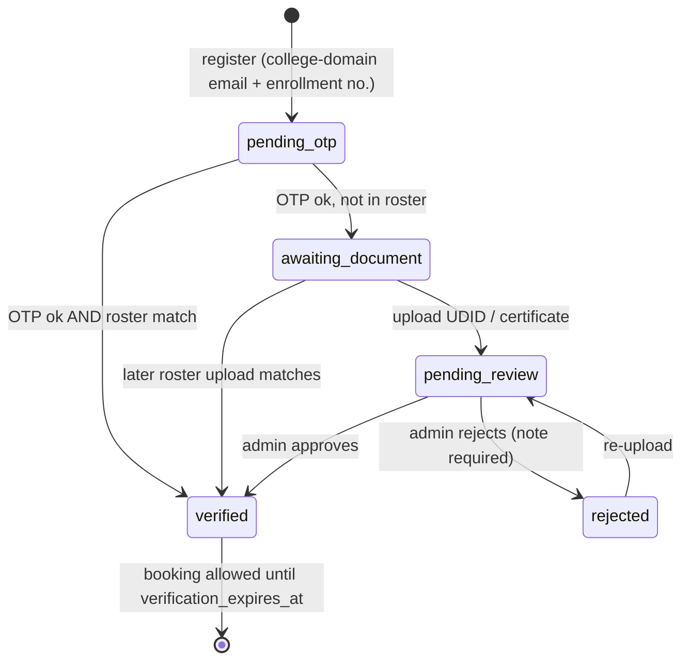
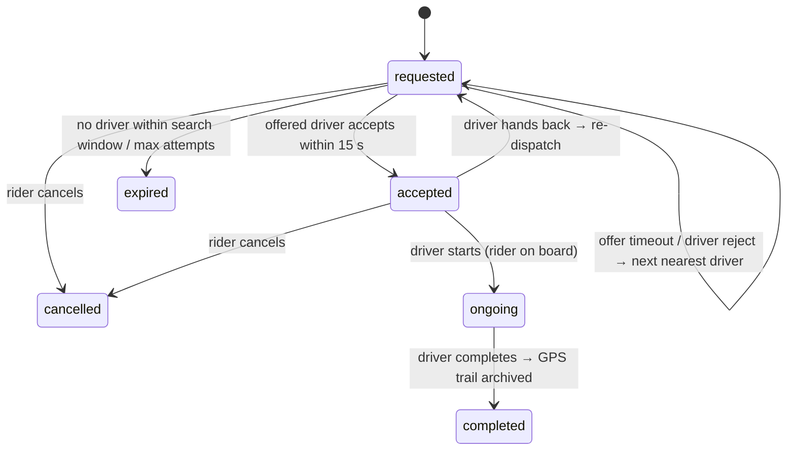

# Architecture and design decisions

This doc covers the parts that took a decision, what the alternatives were, and what changes at
larger scale.

## 1. Service boundaries

| Service | Owns (writes) | Why it's separate |
|---|---|---|
| identity | users, student profiles, OTPs, documents, roster, audit | Security-sensitive; changes slowly; only service that mints JWTs |
| rides | vehicles, driver profiles, rides, ratings, ride trail | Hot path; runs the dispatcher loop |
| location | (Redis only) | Holds long-lived WebSockets; scales on connection count, not CPU |
| notification | (none) | Isolates third-party credentials (SMTP/FCM/Twilio) and their retries/latency |

**Shared database, logical ownership.** All services use one PostGIS database, but each table has
exactly one writing service. Database-per-service would add distributed transactions (e.g. "create
driver user and driver profile") with no benefit at campus scale. Because every table already
carries `college_id`, the data can later be split by service or sharded by tenant.

**Sync vs async calls.** Services call `notification` over REST with an `X-API-Key`, retries with
exponential backoff, and `X-Request-ID` propagation. OTP email is synchronous because the user is
waiting on it. Ride pushes are best-effort, run *after* the DB commit through an `Outbox`, and never
fail the state transition that triggered them. The next step would be a transactional outbox table
or a Redis Stream consumer, for at-least-once delivery.

## 2. Verification pipeline

Decisions:

- **The roster result is hidden until OTP succeeds.** Registration always answers `pending_otp`,
  so nobody can probe the endpoint to learn which enrollment numbers belong to PwD students. That
  is sensitive health information.
- **Name matching is fuzzy but strict.** Accents and punctuation are stripped, tokens are sorted
  ("Kumar Gulshan" = "Gulshan Kumar"), and the strings must reach 0.85 similarity. If the roster
  row has an email, it must match exactly.
- **OTP storage**: `HMAC-SHA256(pepper, user_id:code)`. A leaked row is useless without the pepper,
  and the hash can't be replayed against another account. Only the latest code is valid. Each code
  allows 5 attempts, then locks. Sends have a 60 s cooldown and an hourly cap per user, and Nginx
  also rate-limits per IP.
- **Squatting protection**: if a roll number is claimed but its OTP never confirmed, the claim
  expires. A duplicate claim on a verified roll number is recorded as an `anomaly.*` audit event
  for the admin.
- **Documents**: the file type comes from magic bytes, not the client's Content-Type. Files are
  Fernet-encrypted *in the service* before they reach storage, so the local volume, MinIO or S3
  only ever holds ciphertext. Plaintext is visible only to the same tenant's admin, through an
  endpoint that writes a `document.viewed` audit row on every access.

## 3. Matching and the ride state machine

The concurrency guarantees and how each is enforced:

| Hazard | Guard |
|---|---|
| Two dispatcher replicas offer the same ride | Dispatcher selects with `FOR UPDATE SKIP LOCKED` |
| One driver offered two rides at once | `SET offer:driver:{id} NX EX` lock |
| Two accepts race, or a late accept after timeout | One `UPDATE … WHERE status='requested' AND offered_driver_id=:me AND offer_expires_at > now() RETURNING` |
| Driver/rider ends up with two active rides via any bug | Partial unique indexes `uq_rides_one_active_per_{rider,driver}` |
| A dead driver app keeps receiving offers | Heartbeat ZSET; drivers silent for more than 60 s are filtered out |

`test_concurrent_accepts_only_one_wins` fires 5 simultaneous accepts and asserts exactly one 200.

**Why Redis GEO and not just PostGIS?** Driver positions change every 2–3 s. Writing those to
Postgres would mean constant MVCC churn and index updates for data that is stale seconds later.
Redis holds the hot, disposable state. Postgres holds the durable facts: rides, plus trails
archived on completion. Measured at 50k drivers, Redis takes about 1.0 ms p50, PostGIS+GiST about
3.2 ms, and a naive scan about 87 ms (see README).

## 4. Real-time path

The driver app sends a WebSocket message to the location service. The service updates Redis
(GEO + heartbeat + trail) and `PUBLISH`es to `ride:{id}:events`. Every location-service replica
subscribed to that channel forwards the message to its connected rider. Status changes from
the ride service go to the same channel, so a single socket carries both position and state.

- **Auth is in the first message, not the query string**, which keeps JWTs out of Nginx access
  logs and browser history.
- Server-side throttle of 1 update per second per socket. Senders don't receive their own echo.
  Sockets close with app-level codes (`4401/4404/4409`).
- The location service is stateless apart from open sockets, so it scales horizontally. The
  ceiling is Redis pub-sub fan-out, which at campus scale is a long way off.

## 5. Multi-tenancy

- A **shared schema with a `college_id` column** rather than a schema or database per tenant. It
  is cheapest to operate, one migration covers every college, and cross-college analytics stay
  simple.
- The tenant comes from the JWT (`cid` claim), never from the request body. Every query filters on
  it. Fetching another tenant's record returns **404**, so tenants can't detect each other's data.
- Next step: Postgres Row-Level Security keyed on `SET app.college_id`, as defense in depth
  against a forgotten `WHERE`. At much larger scale, partition big tables (`rides`,
  `ride_locations`) by `college_id`, or shard by it, since there are no cross-tenant joins on the
  hot path.

## 6. Security checklist

- Access tokens last 15 minutes. Refresh tokens rotate and are single-use: a replayed token is
  rejected via a Redis `jti` denylist. Driver, rider and admin roles are enforced per route.
- Login runs bcrypt even for unknown emails (no timing oracle). Passwords are capped at 72 bytes
  (bcrypt's limit) instead of being silently truncated.
- Audit log rows for registrations, approvals, rejections, document views, roster uploads, SOS
  events, driver hand-backs and anomaly flags.
- `notification` is internal-only: the gateway has no route to it, and calls need `X-API-Key`.
- The services refuse to start outside `dev`/`test` while secrets still have `dev-only` placeholders.
- **Known upgrades**: RS256 JWTs (only identity holds the private key), KMS-managed document keys
  with rotation, and RLS (see §5).

## 7. Interview Q&A cheat-sheet

- *How do you stop two drivers getting the same ride?* See the table in §3. The final word is a
  single conditional UPDATE plus a partial unique index.
- *What if the ride service crashes mid-offer?* The offer has an `offer_expires_at`. Any surviving
  replica's sweeper picks the ride up once that passes, because the state lives in Postgres and
  not in process memory.
- *What if Redis is lost?* Rides are safe in Postgres. Drivers re-register on their next heartbeat
  (every 2–3 s), and the live trail of in-flight rides is lost; fallback distance is pickup→drop.
- *Why not Kafka?* Message volume is tiny, and Redis pub-sub covers the ephemeral fan-out. A
  durable event log would arrive with a transactional outbox once there are downstream consumers
  (analytics, billing).

## 8. Bugs real browsers caught

The backend suite was green throughout. Each of these bugs showed up only once real Chromium ran
against the real Docker stack, and each now has a test that stops it coming back.

| Symptom | Root cause | Fix |
|---|---|---|
| Logins failed with **"Not Found"** after backend containers were rebuilt | Nginx resolves `upstream` hostnames **once at startup**. The recreated containers got new IPs, and identity's old IP was reused by the ride service, so `/auth/token` reached the wrong service. Any rolling deploy would hit this. | `resolver 127.0.0.11 valid=10s` plus `proxy_pass http://$upstream` makes Nginx re-resolve service names through Docker DNS at request time. Verified by force-recreating services under a live gateway. |
| The production build rendered **completely unstyled** (dev server was fine) | Angular's critical-CSS inlining loads the full stylesheet with an inline `onload="this.media='all'"` handler, and our CSP (`script-src 'self'`) correctly blocks inline handlers | Disabled `inlineCritical` instead of weakening the CSP. An E2E test now fails if global styles are missing or the browser logs any CSP violation. |
| Map clicks never landed (Playwright: element "not stable") | A CSS-grid `1fr` track has an implicit `min-width: auto`, so the Leaflet canvas widened its own column, which triggered `ResizeObserver` → `invalidateSize()` → wider again: an endless resize loop | `minmax(0, 1fr)` tracks and `min-width: 0` on the map host |

A fourth "failure" was the system working as designed. The per-IP login limiter blocked the E2E
suite, because every test logs in from the same IP. The limits now scale with a
`RATE_LIMIT_MULTIPLIER` setting: 10 in local dev and CI, 1 in production.

## 9. Frontend architecture

- **Angular 20, standalone + signals + zoneless.** All component state is in signals, so change
  detection runs only where a signal changed and there's no Zone.js monkey-patching.
- **One app, three consoles.** Routes are lazy-loaded per role and protected by functional guards.
  The initial bundle is about 85 kB over the wire, so a rider never downloads the admin console.
  One codebase keeps the shared API client, auth and models in sync. Wrapping it in Capacitor
  would give native shells for background GPS and push notifications.
- **Auth.** An HTTP interceptor attaches the access token. On a 401 it performs a **single-flight
  refresh** (concurrent 401s share one refresh call, since refresh tokens are single-use), then
  retries the request once. Tokens live in `localStorage`. The trade-off is XSS exposure, which
  the strict CSP mitigates. The production upgrade is an httpOnly refresh cookie.
- **Real-time.** Each active ride opens one WebSocket that authenticates with its first message
  and reconnects with exponential backoff, but not after a terminal status or an auth or not-found
  close code. A 5-second REST poll of the ride runs alongside it. That covers ETA refreshes and
  keeps the screen correct if the socket drops.
- **Maps without vendor lock-in.** Leaflet with OpenStreetMap tiles needs no API key, which suits
  an app that is free to use. Markers are CSS `divIcon`s, so there are no image assets to bundle.
  OSRM can be plugged in server-side for road routes.
- **Accessibility decisions.** Ride status changes are announced through `aria-live`. The driver's
  offer is an `alertdialog` with a visible countdown. Everything the map shows is also available
  as text. Star ratings are a real radio group. Confirmation dialogs guard destructive and
  emergency actions.
